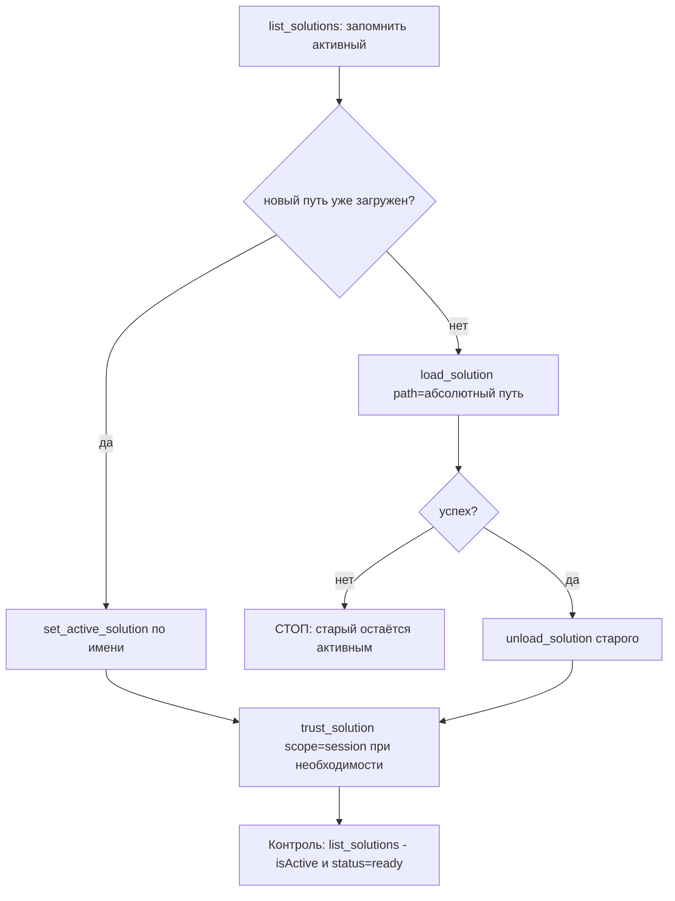

# Правило: мультисолюшен-режим MCP-сервера `roslyn-codelens`

## 1. Проверенные факты о поведении сервера

Все факты подтверждены чтением исходников сервера
(`src/RoslynCodeLens/`) 2026-10-26.

### 1.1. Запуск и автообнаружение

- Позиционные аргументы командной строки = пути к `.sln`/`.slnx`
  ([`CliOptions.Parse()`](src/RoslynCodeLens/CliOptions.cs:28)).
  Флаги — только `--http`, `--port`, `--host`.
- Без аргументов [`Program.cs:30-34`](src/RoslynCodeLens/Program.cs:30)
  вызывает [`SolutionLoader.FindSolutionFile()`](src/RoslynCodeLens/SolutionLoader.cs:666):
  - поиск идёт **вверх** по дереву каталогов от cwd (`dir.Parent` в цикле),
    **вниз не заглядывает**;
  - в каждом каталоге просматриваются `*.sln` и `*.slnx`;
  - при нескольких файлах выбирается **один** — с самой короткой полной
    строкой пути. Остальные игнорируются молча.
- Следствие для этого репозитория: решение
  [`RoslynCodeLens.slnx`](RoslynCodeLens.slnx)
  находится в корне `d:\work\MCP\mcp-roslyn`, поэтому автообнаружение
  его **найдёт** (поиск вверх от cwd найдёт файл в корне).
  Тем не менее явный путь в [`.roo/mcp.json:7`](.roo/mcp.json:7)
  гарантирует однозначность.

### 1.2. Мультисолюшен-менеджер

- [`MultiSolutionManager.CreateAsync()`](src/RoslynCodeLens/MultiSolutionManager.cs:20)
  создаёт **отдельный `SolutionManager` на каждый путь из аргументов**
  (полный `MSBuildWorkspace` + компиляция). Первый успешно загруженный
  становится активным. Сбой одного солюшена не блокирует остальные —
  он пропускается с записью в stderr.
- [`LoadSolutionAsync()`](src/RoslynCodeLens/MultiSolutionManager.cs:200):
  - новый путь → загрузка (~3 с на 3 проектах) и **автоматическая
    активация**;
  - уже загруженный путь без фильтра → мгновенная реактивация;
  - уже загруженный путь **с фильтром** (`include`/`rootProjects`) →
    старый workspace уничтожается и пересоздаётся (replace semantics).
- [`UnloadSolution()`](src/RoslynCodeLens/MultiSolutionManager.cs:259):
  partial case-insensitive match по имени; если выгружался активный —
  активным становится первый из оставшихся (или ни одного).
- [`SetActiveSolution()`](src/RoslynCodeLens/MultiSolutionManager.cs:171):
  partial match; 0 совпадений → `ProjectNotFound`, >1 → `AmbiguousMatch`.

### 1.3. Доверие (trust)

- Session-trust автоматически выдаётся **только** солюшенам из
  CLI-аргументов ([`Program.cs:47-48`](src/RoslynCodeLens/Program.cs:47)).
- Солюшен, догруженный в рантайме через `load_solution`, для
  `get_diagnostics(includeAnalyzers: true)` нужно доверять явно —
  `trust_solution` со `scope: "session"` (или `"persistent"` с разрешения
  пользователя).

### 1.4. Ресурсы

- Каждый загруженный солюшен держит свой скомпилированный workspace:
  память и время загрузки растут линейно с числом проектов.
- 10 солюшенов в `args` = 10 загрузок при **каждом** старте MCP-процесса
  (клиент перезапускает его при старте/релоаде сессии).
- Переменные окружения загрузки: `ROSLYN_CODELENS_OPEN_PROJECT_TIMEOUT_SECONDS`,
  `ROSLYN_CODELENS_LOAD_PARALLELISM`, `ROSLYN_CODELENS_MAX_CONCURRENT_LOADS`,
  `ROSLYN_CODELENS_LOAD_RETRIES` (только тюнинг, не пути к солюшенам).

## 2. Сценарии

### S1. Один солюшен (текущая базовая конфигурация)

Один явный путь в `args` [`.roo/mcp.json`](.roo/mcp.json). Ничего менять
не нужно. Правило из [`.roo/rules/02-roslyn-codelens.md`](.roo/rules/02-roslyn-codelens.md)
(«жизненный цикл решения») покрывает полностью.

### S2. Папка с N солюшенами

- В `args` держать **1–2** реально используемых солюшена (старт быстрый,
  они сразу активны и доверены).
- Остальные подключать по требованию через `load_solution` и **обязательно**
  выгружать через `unload_solution` после завершения задачи.
- На автообнаружение не полагаться: оно возьмёт один файл с кратчайшим
  путём и проигнорирует остальные (раздел 1.1).

### S3. Переключение активного решения («вместо текущего»)

Порядок **сначала новый, потом выгрузка старого** — если новый не
загрузится, старый останется рабочим:

Полная пошаговая процедура — в скилле
[`.roo/skills/switch-solution/SKILL.md`](.roo/skills/switch-solution/SKILL.md).

### S4. Большие солюшены (сотни проектов)

- `load_solution` с `include` (глобы по имени `.csproj` без расширения)
  или `rootProjects` (точные имена) — загрузится транзитивное замыкание
  `ProjectReference` от указанных корней.
- Пустой результат фильтра = ошибка, тихого отката на полную загрузку нет.
- `background: true` → сразу возвращается `taskId`, опрос через
  `get_task_status`; солюшен становится активным только после завершения.

### S5. Освобождение памяти

- `unload_solution` по partial-имени; выгружать солюшены, с которыми
  работа закончена.
- Не выгружать солюшен, пока `list_running_tasks` показывает незавершённые
  фоновые задачи.

## 3. Граничные случаи

| Случай | Поведение |
|---|---|
| Относительный путь к солюшену | Нормализовать до абсолютного относительно корня репозитория `d:/work/MCP/mcp-roslyn` |
| `AmbiguousMatch` в `set_active_solution`/`unload_solution` | Уточнить имя более длинным уникальным фрагментом пути |
| `load_solution` завершился ошибкой | Старый солюшен не выгружать; сообщить текст ошибки пользователю |
| Нужны диагностики анализаторов для рантайм-солюшена | `trust_solution` со `scope: "session"` (persistent — только с разрешения пользователя) |
| Повторная загрузка того же пути с фильтром | Это замена workspace (старый фильтр теряется), а не дополнение |

## 4. Базовая конфигурация

- Единственное решение репозитория — `RoslynCodeLens.slnx` —
  указано явным аргументом в `.roo/mcp.json`. Решение находится в корне
  репозитория, поэтому автообнаружение (поиск вверх от рабочего каталога)
  его найдёт. Явный путь из `args` не удалять — он гарантирует
  однозначность.

## 5. Бюджет загруженных решений

- Каждое загруженное решение — отдельный скомпилированный Roslyn-workspace:
  память и ~3 с на 3 проекта при каждом старте MCP-процесса.
- В `args` `.roo/mcp.json` держать не более 1–2 солюшенов.
- Остальные подключать по требованию через `load_solution` и обязательно
  выгружать через `unload_solution` после завершения задачи.

## 6. Переключение решения: сначала новый, потом выгрузка старого

1. `list_solutions` — зафиксировать текущее активное решение.
2. `load_solution` с абсолютным путём нового `.sln`/`.slnx`
   (успешная загрузка сама делает его активным).
3. Только после успешной загрузки — `unload_solution` старого.
4. Загрузка не удалась — старый солюшен не выгружать, сообщить ошибку.

Пошаговая процедура — скилл `switch-solution`.

## 7. Доверие (trust)

- Session-trust автоматически получают только солюшены из CLI-аргументов.
- Для солюшена, догруженного через `load_solution`, перед
  `get_diagnostics(includeAnalyzers: true)` вызвать `trust_solution`
  со `scope: "session"`. `scope: "persistent"` — только с явного
  разрешения пользователя.

## 8. Безопасность

- Не вызывать `unload_solution`, пока `list_running_tasks` показывает
  незавершённые фоновые задачи.
- `set_active_solution` и `unload_solution` принимают partial-имя;
  при неоднозначности (AmbiguousMatch) использовать более длинный
  уникальный фрагмент пути.
- Повторный `load_solution` уже загруженного пути с фильтром
  (`include`/`rootProjects`) заменяет workspace (replace semantics),
  а не дополняет прежний фильтр.
