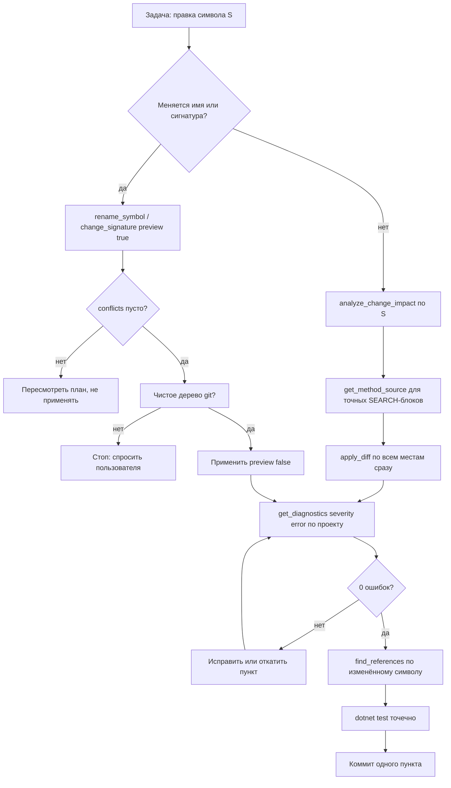

# Скилл: протокол правки `.cs` с обязательной валидацией

Цель — одна правка = один проверенный шаг. Агент не закрывает задачу
«должно компилироваться»: должно быть **доказано** диагностикой.

Режим выполнения: **Code**.

> Базовые правила MCP (жизненный цикл решения, дефекты, безопасность) —
> скилл `roslyn-codelens-usage`. Систематические аудиты — `solid-architecture-audit`,
> поэтапное выполнение SOLID-плана — `solid-plan-implementation`.
> Здесь — только **каждая отдельная правка**.

---

## 0. Опорные факты (проверено по исходникам сервера, 2026-10-28)

1. Сервер **сам** отслеживает изменения на диске
   (`FileChangeTracker`, дебаунс 200 мс, транзитивные зависимости) и перед
   каждым инструментом делает инкрементальный rebuild устаревших проектов
   (`RebuildIfStale`). **`rebuild_solution` после каждой правки `.cs` не
   нужен.**
2. После правок самого MCP (`rename_symbol`, `change_signature`,
   `apply_code_action` с `preview: false`) снапшот обновляется немедленно
   (`CommitAsync`) — следующий запрос видит новый текст.
3. Перед записью на диск сервер сверяет текущее содержимое файла со
   снапшотом (freshness precheck) и считает дельту ошибок компиляции:
   правка, вводящая новые ошибки, **отклоняется** (`Conflicts`), запись
   атомарна с откатом батча.
4. Файл **вне** загруженного решения семантически невидим: `FileNotFound`,
   пустой `find_references`. Это не «проверено и чисто».

---

## 1. Цикл правки

## 2. Таблица «тип правки → обязательная проверка»

| Тип правки | Обязательная проверка | Инструмент |
|---|---|---|
| Любая правка `.cs` **внутри** решения | `severity: error` → затем `warning` | `get_diagnostics` (после плана 27 — `validate_edit`) |
| Изменено **имя** символа | `preview: true` → `conflicts` → `preview: false` | `rename_symbol` |
| Изменена **сигнатура** | то же, каскад на все вызовы | `change_signature` |
| Символ **удалён/перенесён** | 0 ссылок | `find_references` |
| Изменён **контракт** (интерфейс, база) | полнота реализаций + диагностики всех затронутых проектов | `find_implementations`, `get_type_hierarchy` |
| Изменено **поведение** | тесты | `dotnet test` (`.roo/rules-code/01-test.md`) |
| `.csproj` / props / NuGet / новый файл | полный reload, затем диагностики | `rebuild_solution` / `start_background_task` |
| Только `.md` / `.ps1` / `.json` / `.sql` | MCP не применим | — |
| Файл вне загруженного решения | MCP не применим | `read_file` / `search_files` |

## 3. Таблица «плохая привычка → правильный вызов»

| Ситуация | Плохо | Правильно |
|---|---|---|
| Где используется `X`? | `search_files "X"` | `find_references` (+ `kinds: ["write","readwrite"]` для присваиваний) |
| Кто вызывает метод? | поиск `.Method(` | `find_callers` / `analyze_method` |
| Что сломается от правки? | гадать | `analyze_change_impact` (+ `get_call_graph callers`) |
| Тело метода целиком | `read_file` всего файла | `get_method_source(["Type.Member"])` (батчево) |
| Есть ли уже такой метод? | поиск по имени текстом | `search_symbols` + `get_type_overview` |
| Как сконструировать тип в тесте? | угадывать конструктор | `get_instantiation_options` (`fromProject` для internal) |
| Какие типы в файле? | regex `class|record` | `get_file_overview` |
| Чем прикрыто тестами? | имена тестов | `get_test_summary` (`referencedSymbols`) |
| Почему упало? | искать строку в логе | `resolve_stack_trace` (полный `Exception.ToString()`) |
| Не сломан ли публичный API? | — | `get_public_api_surface` → `find_breaking_changes` |
| Не нарушены ли слои? | смотреть `using` | `check_architecture` (`forbid`/`allowOnly`) |

Экономия контекста — часть качества: батчевые `get_method_source`/
`get_overloads`, `limit` + `summary.byKind` вместо полных списков,
`get_project_health(hotspotsPerDimension: 0)` для быстрого среза.

## 4. Точные SEARCH-блоки для `apply_diff`

`apply_diff` атомарен: один несовпавший блок отменяет весь набор. Поэтому:

1. `get_method_source` (или `get_file_overview`) — получить **фактический**
   текст и отступы; не воспроизводить по памяти.
2. Все места, которые затрагивает изменение сигнатуры/типа, править в одном
   наборе (иначе решение не скомпилируется между шагами).
3. Для структурных преобразований (извлечь метод, инвертировать условие,
   обернуть в `using`) предпочитать `get_code_actions` →
   `apply_code_action` — правку делает Roslyn.
4. Один несовпавший блок — не «переписать всё», а заново прочитать участок.

## 5. Запреты

- Не закрывать задачу правки `.cs` без диагностики затронутого проекта.
- Не искать имя символа через `search_files`, если файл входит в решение.
- Не применять `rename_symbol` / `change_signature` / `apply_code_action`
  с `preview: false` без проверки `conflicts` и чистого дерева git.
- Не вызывать `rebuild_solution` после каждой правки `.cs`.
- Не удалять «неиспользуемое» по одному `find_unused_symbols` без
  `find_references`.
- Не останавливать процессы без явного разрешения пользователя.
