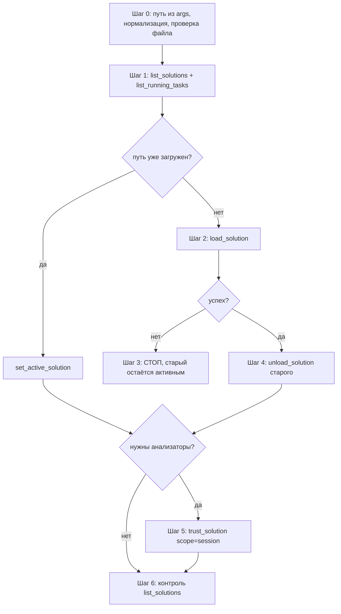

# Скилл: подключение нового солюшена вместо текущего

Цель — безопасно заменить активное решение в MCP-сервере
`roslyn-codelens`: загрузить новый `.sln`/`.slnx` и только после
подтверждённого успеха выгрузить старый, освободив память.

**Параметр скилла (`args`)**: путь к файлу `.sln` или `.slnx`.
Путь может быть относительным (от корня репозитория `d:/work/MCP/mcp-roslyn`)
или абсолютным.

> Базовые правила работы с сервером — скилл `roslyn-codelens-usage`.
> Обоснование порядка шагов и факты о поведении сервера —
> [`.roo/rules/03-multisolution.md`](.roo/rules/03-multisolution.md).

---

## Шаг 0. Разбор параметра

1. Если `args` пуст или не содержит пути к `.sln`/`.slnx` — спросить
   пользователя через `ask_followup_question`, предложить конкретные пути
   из известных каталогов.
2. Проверить расширение: только `.sln` или `.slnx`. Иное расширение —
   ошибка, дальше не идти.
3. Относительный путь нормализовать до абсолютного относительно корня
   `d:/work/MCP/mcp-roslyn`.
4. Проверить существование файла (`read_file` или `list_files` каталога).
   Файла нет — сообщить пользователю, завершить.

## Шаг 1. Зафиксировать текущее состояние

1. `list_solutions` — запомнить:
   - путь к текущему **активному** решению (`isActive: true`);
   - полный список загруженных решений.
2. `list_running_tasks` — если есть незавершённые фоновые задачи,
   дождаться их завершения (`get_task_status`) или спросить пользователя.
   Выгружать солюшен при активных фоновых задачах запрещено.

## Шаг 2. Загрузить новый солюшен

1. Если путь из Шага 0 уже есть в списке из Шага 1:
   - без фильтра — `set_active_solution` с уникальным фрагментом имени
     (мгновенная реактивация);
   - нужен фильтр `include`/`rootProjects` — повторный `load_solution`
     с фильтром **заменит** прежний workspace (replace semantics).
2. Иначе `load_solution` с абсолютным путём:
   - обычный размер (до ~50 проектов) — синхронно, загрузка ~3 с;
   - гигантский солюшен (сотни проектов) — `background: true`, затем опрос
     `get_task_status` по `taskId` до статуса `Succeeded`; решение станет
     активным только после завершения.
3. Проверить ответ: количество загруженных проектов, `skippedProjects`,
   предупреждения о `degradedProjects` (нерезолвленные ссылки — результаты
   по этим проектам могут быть неполными).

## Шаг 3. Точка отказа

Если `load_solution` завершился ошибкой (файл не найден, сбой загрузки,
таймаут):

- **старый солюшен не выгружать** — он остаётся активным и рабочим;
- сообщить пользователю точный текст ошибки;
- завершить скилл без дальнейших шагов.

## Шаг 4. Выгрузить старый солюшен

Только после подтверждённого успеха Шага 2:

1. `unload_solution` с уникальным фрагментом имени старого решения
   (из Шага 1).
2. При `AmbiguousMatch` — удлинить фрагмент имени до однозначного.
3. При `ProjectNotFound` — сверить имя с выводом `list_solutions`.

## Шаг 5. Доверие для анализаторов (по необходимости)

Рантайм-солюшены (не из CLI-аргументов `.roo/mcp.json`) не получают
session-trust автоматически. Если дальнейшая работа требует
`get_diagnostics(includeAnalyzers: true)`:

1. `trust_solution` со `scope: "session"` для нового пути.
2. `scope: "persistent"` — только с явного разрешения пользователя
   (меняет `trust.json` на диске).

## Шаг 6. Контроль

1. `list_solutions` — убедиться:
   - новый солюшен `isActive: true`, `status: "ready"`;
   - старый солюшен отсутствует в списке;
   - `projectCount` соответствует ожиданиям.
2. Сообщить пользователю итог: путь, число проектов, пропущенные проекты
   (если были), состояние доверия.

---

## Краткая схема

## Типичные ошибки

| Ошибка | Причина | Действие |
|---|---|---|
| `Solution file not found` | Неверный путь | Шаг 0: нормализация, проверка существования |
| `AmbiguousMatch` | Partial-имя совпало с несколькими решениями | Удлинить фрагмент имени |
| `No solution loaded` после выгрузки | Выгружен единственный солюшен | `load_solution` заново |
| `SolutionNotTrusted` при `includeAnalyzers: true` | Рантайм-солюшен без доверия | Шаг 5: `trust_solution` |
| Долгая загрузка гигантского солюшена | Сотни проектов | `background: true` + `get_task_status`, либо фильтр `include`/`rootProjects` |
