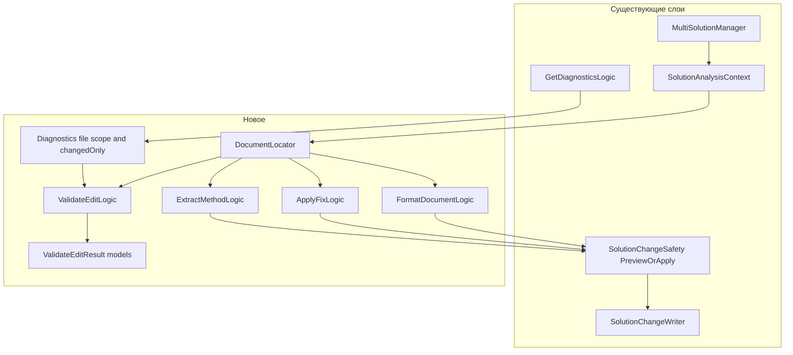
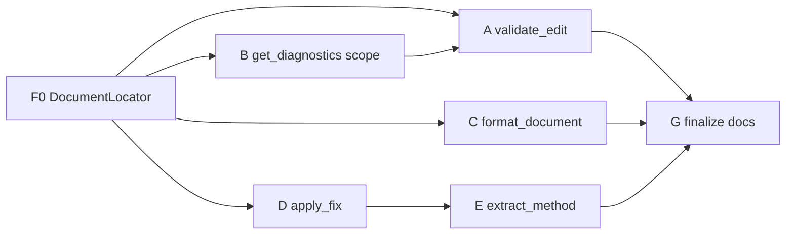

# План 27: расширение MCP-сервера `roslyn-codelens` (write-side gate и диагностика)

Дата: 2026-10-28. Статус: на согласовании (ожидает утверждения перед реализацией).
Основание: отчёт [`plans/27_roslyn-codelens-edit-quality-report.md`](27_roslyn-codelens-edit-quality-report.md)
(в LLMNetHelper), разделы 1, 3, 5.

Целевой репозиторий: `D:\work\MCP\mcp-roslyn`
(сервер `RoslynCodeLens`, `net10.0`, Roslyn 5.9.0, MCP SDK 2.3.0).

---

## 1. Цель и границы

### 1.1. Проблема

Агент после каждой правки `.cs` вынужден делать 2–4 отдельных вызова
(`get_diagnostics` → `get_file_overview` → `find_references`), чтобы понять,
не сломал ли он решение. Это дорого по ходам и по контексту, и на практике
пропускается — отсюда класс ошибок «осталась незаменённая ссылка» и «правка
внесена, но не проверена».

Дополнительные пробелы, выявленные разбором исходников сервера:

| Пробел | Факт в коде |
|---|---|
| Нет форматирования | `Formatter` не используется нигде (`search: Formatter\.` → 0 совпадений в `src/RoslynCodeLens`) |
| Диагностики нельзя ограничить файлом | [`CollectCompilerDiagnostics`](../src/RoslynCodeLens/Tools/GetDiagnosticsLogic.cs:92) фильтрует только по `project` (подстрока имени) |
| `get_code_fixes` возвращает правки, но применить их нечем | [`GetCodeFixesLogic`](../src/RoslynCodeLens/Tools/GetCodeFixesLogic.cs:8) отдаёт `CodeFixSuggestion`, отдельного apply-инструмента нет |
| Нет первоклассного извлечения метода | провайдеры features загружаются ([`CodeActionRunner`](../src/RoslynCodeLens/CodeActionRunner.cs:93)), но доступны только через `get_code_actions`/`apply_code_action` по заголовку |
| Поиск/правка дублируют обход `Projects[].Documents[]` | одинаковый цикл в `ApplyCodeActionLogic`, `GetCodeFixesLogic`, `GetFileOverviewLogic`, `GetCodeActionsLogic` |

### 1.2. Что входит в план

- Этап A: `validate_edit` — единый post-edit gate (главный пункт).
- Этап B: скоуп `get_diagnostics` по файлу и режим «только изменённое».
- Этап C: `format_document` с `.editorconfig` и safety-гейтом.
- Этап D: `apply_fix` (применение фикса по `DiagnosticId` + позиции).
- Этап E: `extract_method` как фасад над Roslyn-провайдером.
- Этап F: сервис `DocumentLocator` (устранение дублирования поиска документа),
  регрессионные тесты, документация (`README.md`, `docs/features.md`,
  `docs/BACKLOG.md`, `.mcp/server.json` не требует правки — версия
  штампуется сборкой).

### 1.3. Что НЕ входит

- `extract_interface` / `encapsulate_field` / `add_member` / `move_member`
  (приоритет 2–3 отчёта; отдельный план после обкатки `extract_method`).
- `find_nullability_mismatches`, `get_analyzer_config`, source-gen/AOT
  инструменты, `run_incremental_tests` (приоритет 3).
- Любые runtime-данные (coverlet/dotCover), «health score».
- Изменение транспорта и модели доверия (trust) — без изменений.
- Изменения в репозитории `LLMNetHelper` — они делаются **после** этого
  плана, отдельным шагом (раздел 8).

---

## 2. Опорные факты о кодовой базе сервера (проверено)

1. Инструмент = статический класс с `[McpServerToolType]` и методом
   `[McpServerTool(Name = "...")]`, входные параметры — с
   `[Description]`, DI-зависимости (`MultiSolutionManager`, `Security.TrustStore`,
   `Security.AnalyzerAllowlist`, `BackgroundTaskStore`) приходят параметрами
   метода; регистрация — `WithToolsFromAssembly()`
   ([`Program.cs:88`](../src/RoslynCodeLens/Program.cs:88)).
   Разделение: `<Tool>.cs` (обёртка, `Description`) + `<Tool>Logic.cs`
   (логика, тестируемая без MCP).
2. Обёртка ошибок `StructuredErrorToolWrapper` применяется ко всем
   инструментам автоматически ([`Program.cs:69`](../src/RoslynCodeLens/Program.cs:69)),
   поэтому логика может `throw new McpToolException(ToolErrorCode.X, msg, ctx)`
   и это станет структурированным ответом. Перечень кодов:
   [`ToolErrorCode`](../src/RoslynCodeLens/Models/ToolErrorCode.cs:3).
3. Консистентный снимок состояния выдаёт `manager.GetAnalysisContext()`
   ([`SolutionAnalysisContext`](../src/RoslynCodeLens/SolutionAnalysisContext.cs:12)) —
   брать `Loaded`/`Resolver`/`Metadata` только из него.
4. Запись на диск — **только** через
   [`SolutionChangeSafety.PreviewOrApplyAsync`](../src/RoslynCodeLens/SolutionChangeSafety.cs:70)
   (гейт degraded-load, конфликты-ошибки, freshness precheck, атомарная запись
   с откатом) + `SolutionChangeWriter.CommitAsync` для обновления in-memory
   снапшота. Дублировать эту последовательность в новом инструменте нельзя.
5. Перед каждым инструментом сервер сам делает инкрементальный rebuild
   устаревших проектов
   ([`RebuildIfStale`](../src/RoslynCodeLens/SolutionManager.cs:218)),
   поэтому новый инструмент не должен вызывать `rebuild_solution`.
6. Диагностики собираются по `loaded.Compilations`
   (`ConcurrentDictionary<ProjectId, Compilation>`), путь файла в
   `DiagnosticInfo.File` — полный путь из `Location.GetLineSpan()`.
7. `DiagnosticInfo` — `record` с полями `Id, Severity, Message, File, Line,
   Project, Source` (см. `Models/DiagnosticInfo`); для нового скоупа
   потребуется добавить `Column` (обратносовместимо: новый обязательный
   параметр записи ломает тесты — добавлять со значением по умолчанию
   нельзя для positional record, поэтому — инициализатор или отдельный
   тип результата, см. §B.2).
8. Форматирование: `AdhocWorkspace` в сервере уже используется
   ([`SolutionLoader`](../src/RoslynCodeLens/SolutionLoader.cs:455)), пакеты
   `Microsoft.CodeAnalysis.CSharp.Features` и `...Features` подключены
   ([`RoslynCodeLens.csproj:41-42`](../src/RoslynCodeLens/RoslynCodeLens.csproj:41)),
   значит `Microsoft.CodeAnalysis.Formatting.Formatter` доступен без новых
   зависимостей.
9. Тесты: проект `tests/RoslynCodeLens.Tests` с фикстурным решением; стиль —
   `Facts`/`Theories` на `<Tool>Logic` напрямую (см. упоминания в
   `docs/BACKLOG.md`), проверки через `Assert.NotEmpty` как страховку от
   вакуумных тестов.

---

## 3. Архитектура изменений



Принципы:

1. **Один сервис поиска документа** — `DocumentLocator`, чтобы новый код не
   повторял цикл `foreach project / foreach doc`.
2. **Все пишущие инструменты идут через `PreviewOrApplyAsync`** — одинаковые
   гарантии и одинаковый словарь результата (`applied`, `edits`, `conflicts`,
   `message`).
3. **`validate_edit` только читает** — никаких operаций записи, только
   диагностика и проверки.
4. Обратная совместимость: существующие параметры и поля ответов не удаляются,
   только добавляются (optional).

---

## 4. Этапы (по шагам, с критериями готовности)

Каждый этап = отдельный коммит. Перед началом — `dotnet build` и
`dotnet test` зелёные (базовая линия).

### Этап F0 — подготовка: `DocumentLocator` (делается первым, хотя пишется как «F» в §1.2)

Почему первым: все новые инструменты опираются на единый поиск документа, а
заодно уходит дублирование из четырёх существующих логик.

1. Новый файл `src/RoslynCodeLens/DocumentLocator.cs`:

```csharp
namespace RoslynCodeLens;

/// <summary>
/// Единая точка поиска документа по абсолютному пути: убирает четыре копии
/// цикла project/document и даёт один и тот же ответ на вопрос
/// «в каком проекте и документе этот файл».
/// </summary>
public static class DocumentLocator
{
    public static bool TryFind(
        LoadedSolution loaded, string filePath,
        out Project project, out Document document);
}
```

Требования:
- нормализация `Path.GetFullPath`, сравнение `OrdinalIgnoreCase`;
- ненайденный файл → `false` (не исключение) — вызывающий сам решает
  (`get_file_overview` бросает `FileNotFound`, `apply_code_action` возвращает
  `Success:false`);
- отдельный метод `TryFindInProject(Project, path, out Document)` для
  сценариев, где проект уже известен;
- XML-doc с указанием, что документ может быть сгенерированным (Razor) —
  см. `GetFileOverviewLogic.FindGeneratedDocumentForMarkupAsync`
  ([`GetFileOverviewLogic.cs:80`](../src/RoslynCodeLens/Tools/GetFileOverviewLogic.cs:80));
  генерация **не** входит в `TryFind` (остаётся в `get_file_overview`).

2. Заменить четыре копии цикла на вызов `DocumentLocator.TryFind`:
   [`ApplyCodeActionLogic`](../src/RoslynCodeLens/Tools/ApplyCodeActionLogic.cs:18),
   [`GetCodeActionsLogic`](../src/RoslynCodeLens/Tools/GetCodeActionsLogic.cs:16),
   [`GetCodeFixesLogic`](../src/RoslynCodeLens/Tools/GetCodeFixesLogic.cs:18),
   [`GetFileOverviewLogic.FindDocument`](../src/RoslynCodeLens/Tools/GetFileOverviewLogic.cs:52)
   (последний оставляет за собой Razor-фолбэк).

3. Тесты `tests/RoslynCodeLens.Tests/DocumentLocatorTests.cs`: найденный файл,
   ненайденный, путь в другом регистре, файл в проекте-ссылке.

**Критерий готовности:** все существующие тесты зелёные, поведение четырёх
инструментов не изменилось (регрессия ловится их же наборами).

---

### Этап A — `validate_edit` (приоритет 1)

#### A.1. Контракт

`validate_edit` — read-only сводка «правка не сломала решение». Один вызов
заменяет цепочку «diagnostics → file overview → references».

Входные параметры:

| Параметр | Тип | Обяз. | Смысл |
|---|---|---|---|
| `filePaths` | `string[]` | да | файлы, которые правил агент (1..N) |
| `symbols` | `string[]?` | нет | символы, чьи ссылки надо проверить на «висячесть» (имя типа/члена) |
| `severity` | `string?` | нет | минимум: `'error'` (по умолчанию — только ошибки) или `'warning'` |
| `includeAnalyzers` | `bool` | нет | как в `get_diagnostics`; требует trust |
| `baselineFile` | `string?` | нет | путь к JSON-снимку прошлого ответа: с ним считается дельта «новые/исчезли» |

Выход — один объект `ValidateEditResult` (не envelope, это сводка):

```json
{
  "passed": false,
  "files": [
    {
      "filePath": "...\\AstPatcher.cs",
      "project": "LLMNetHelper.Roslyn",
      "typesDefined": ["PatchResult", "AstPatcher"],
      "errors": [ ...DiagnosticInfo... ],
      "warnings": [ ... ],
      "analyzerFindings": [ ... ]
    }
  ],
  "newErrors": [ ... ],          // есть только при baselineFile
  "resolvedErrors": [ ... ],     // есть только при baselineFile
  "symbols": [
    {
      "symbol": "AstPatcher",
      "resolved": true,
      "referenceCount": 4,
      "byKind": { "usage": 1, "type_argument": 1, "object_creation": 2 },
      "danglingCandidates": []   // символ не найден, но имя встречается в тексте
    }
  ],
  "summary": {
    "errorCount": 0,
    "warningCount": 0,
    "filesChecked": 1,
    "symbolsChecked": 1,
    "skippedFiles": [ "D:\\...\\outside-solution.cs" ],
    "loadDegraded": false
  },
  "message": "No new compiler errors. Rebuild not required."
}
```

Семантика `passed`:
- `true` — по проверяемым `filePaths` **0 ошибок** (и 0 новых против
  baseline, если он задан) **и** каждый `symbols[i]` разрешён с
  `referenceCount >= 0` (символ найден);
- `false` — иначе. Детали всегда в теле, одно поле `message` — для агента,
  который читает только строку.

Семантика `danglingCandidates`:
- если символ **не разрешился** (`resolved: false`), это уже провал: правка
  удалила/переименовала тип или член, который ещё кто-то упоминает
  текстово. `danglingCandidates` перечисляет файлы, где имя встречается как
  подстрока (поиск по синтаксическому дереву: `IdentifierNameSyntax`,
  `GenericNameSyntax`, XML-doc `cref`), с ограничением `limit` (по умолчанию
  50). Это «мягкая» подсказка: реальные ссылки компилятор уже показал бы
  ошибкой, а текстовые упоминания (комментарии, строки конфигурации) — нет.

`skippedFiles`: файлы, не найденные в загруженном решении. Это **не**
ошибка инструмента: агент мог валидировать файл другого репозитория.
Сообщать явно, чтобы агент не принял `passed: true` за проверку чужого файла.

#### A.2. Реализация

Файлы:

1. `src/RoslynCodeLens/Models/ValidateEditResult.cs` — записи
   `ValidateEditResult`, `FileValidationReport`, `SymbolValidationReport`,
   `ValidateEditSummary`, `ValidationDiagnostic` (или переиспользовать
   `DiagnosticInfo`; см. §B.2 про колонку).
2. `src/RoslynCodeLens/Tools/ValidateEditLogic.cs`:

```csharp
public static async Task<ValidateEditResult> ExecuteAsync(
    LoadedSolution loaded, SymbolResolver resolver,
    IReadOnlyList<string> filePaths, IReadOnlyList<string>? symbols,
    string? severity, bool includeAnalyzers,
    Security.TrustStore trustStore, Security.AnalyzerAllowlist allowlist,
    ValidateEditBaseline? baseline, CancellationToken ct);
```

Алгоритм:
1. `DocumentLocator.TryFind` по каждому пути; не найденные → `skippedFiles`.
2. Собрать диагностики **только для найденных файлов**: вызвать
   `GetDiagnosticsLogic.ExecuteAsync(..., project: <имя проекта файла>, ...)`
   и отфильтровать по `d.File == fullPath` (см. этап B — он добавляет
   серверный фильтр, и здесь используется он).
3. Для `symbols`: `resolver.FindSymbols(symbol)`; если пусто —
   `resolver` не нашёл → попробовать `MetadataSymbolResolver`; всё ещё пусто →
   `resolved: false` + текстовые кандидаты (поиск по `IdentifierNameSyntax`
   через `SolutionScanner.EnumerateTrees`).
4. Если найден — `FindReferencesLogic.Execute` и агрегировать `byKind`.
5. `baseline` — сравнение с прошлым JSON по ключу
   `(Id, File, Line, Column, Message)`; в `newErrors` — только появившиеся.
6. `passed` по правилам §A.1; `message` формируется по шаблону:
   - `"{n} error(s) in edited file(s). Fix before continuing."`
   - `"No new compiler errors. Rebuild not required."`
   - `"Edited file(s) are outside the loaded solution: <list>. Roslyn cannot verify them."`

3. `src/RoslynCodeLens/Tools/ValidateEditTool.cs` — обёртка с
   `[McpServerTool(Name = "validate_edit")]` и `Description`, явно
   сообщающим, когда использовать (после правки `.cs`), а когда нет
   (не-C#, вне решения, `.csproj` → `rebuild_solution`).

4. `--baseline-out` в самом инструменте **не** делать: агент сохраняет JSON
   сам (у него есть файловые инструменты). Альтернатива, если понадобится:
   параметр `writeBaselineTo` — но тогда это уже запись файла, а значит
   нужен отдельный путь безопасности. Вынести в отложенные.

#### A.3. Тесты `tests/RoslynCodeLens.Tests/ValidateEditLogicTests.cs`

Обязательные кейсы:
1. Файл без ошибок → `passed: true`, `errorCount: 0`.
2. Внести синтаксическую ошибку в фикстуру → `passed: false`, ошибка в
   `files[0].errors`, `Id` начинается с `CS`.
3. Существующий символ → `resolved: true`, `referenceCount > 0`,
   `byKind` непустой.
4. Несуществующий символ + текстовое упоминание в комментарии →
   `resolved: false`, `danglingCandidates` содержит файл.
5. Путь вне решения → `skippedFiles` содержит путь, `passed` **не**
   становится `true` из-за пустого `errors` (явное правило: если
   `filesChecked == 0` и `skippedFiles.Count > 0`, то `passed: false`).
6. Baseline-дельта: baseline без ошибки, текущий с ошибкой → `newErrors`
   содержит ровно одну запись; обратный случай → `resolvedErrors`.
7. `Assert.NotEmpty`-страховка: тест 3 обязан упасть, если фикстура
   перестанет содержать ссылки (по образцу исправления вакуумного теста в
   `docs/BACKLOG.md`, раздел «Deferred from shipped features»).

**Критерий готовности:** `dotnet test` зелёные, включая новый набор; в
`README.md` и `docs/features.md` добавлено описание инструмента.

---

### Этап B — скоуп `get_diagnostics` по файлу и режим `changedOnly`

#### B.1. Новые параметры `get_diagnostics`

```csharp
[Description("Optional file path filter — only diagnostics whose file path matches (exact, case-insensitive)")]
string? filePath = null,

[Description("Only diagnostics in documents changed since the last solution snapshot (uses the file change tracker)")]
bool changedOnly = false,
```

- `filePath` — точное совпадение (нормализованный путь). Не подстрока, чтобы
  `AstPatcher.cs` не цеплял `AstPatcherTests.cs`; при желании `contains: true`
  отдельным флагом — не делать сейчас.
- `changedOnly` — список изменённых документов берётся из
  [`FileChangeTracker`](../src/RoslynCodeLens/FileChangeTracker.cs:87)
  (`DrainStale` **нельзя** — он очищает состояние; нужен новый
  неразрушающий метод `SnapshotChangedDocuments()`). Важно: после
  `RebuildIfStale` список уже пуст, поэтому `changedOnly` должен опираться
  на **журнал правок** — новый член в `SolutionManager`:
  `IReadOnlyList<string> RecentlyChangedDocuments { get; }`, накапливающий
  пути при каждом rebuild/commit и очищаемый только явным вызовом
  (`resetRecentChanges: true` параметр `get_diagnostics`). Простая и
  предсказуемая семантика: «изменённые с последнего сброса».

Решение по умолчанию: **`changedOnly` реализуется только для .cs документов**
и только по факту watcher/commit; `.csproj` в журнал не попадает (для них —
`rebuild_solution`).

#### B.2. Колонка в диагностиках

Агенту нужна позиция для `apply_fix` (этап D). Сейчас `DiagnosticInfo`
содержит `Line`, но не `Column`. Варианты:
- **Рекомендуемый:** добавить `int Column` в `DiagnosticInfo` как
  positional-параметр **в конец** и обновить все конструкторы (поиск по
  `new DiagnosticInfo(` — их немного). Это ломает только внутренние вызовы,
  JSON-совместимость сохраняется (новое поле).
- Альтернатива: `ValidateEdit`/`apply_fix` считают колонку сами. Хуже —
  дублирование `GetLineSpan`.

Принять первый вариант, с проверкой всех мест создания в
`GetDiagnosticsLogic` и `GetFileOverviewLogic`.

#### B.3. Тесты

1. `filePath` возвращает только диагностики этого файла (фикстура: ошибка в
   двух файлах, фильтр по одному).
2. Фильтр `project` + `filePath` одновременно = пересечение.
3. `changedOnly: true` после прямой правки файла на диске (тестовый шов
   [`NotifyChangedPathForTest`](../src/RoslynCodeLens/FileChangeTracker.cs:148))
   возвращает диагностики этого файла; после `resetRecentChanges: true` —
   пусто.
4. `Column` заполнена и совпадает с `GetLineSpan().StartLinePosition.Character + 1`.

**Критерий готовности:** сводка `get_diagnostics` не изменилась по форме;
новые параметры не влияют на существующие вызовы.

---

### Этап C — `format_document`

#### C.1. Контракт

| Параметр | Тип | Обяз. | Смысл |
|---|---|---|---|
| `filePath` | `string` | да | целевой `.cs` |
| `preview` | `bool` | нет | по умолчанию `true` |
| `lineRange` | `int[]?` | нет | `[startLine, endLine]` — форматировать фрагмент (через `TextSpan`) |
| `force` | `bool` | нет | как в `rename_symbol` (обход degraded-load) |

Выход — `CodeActionResult`-подобный: `{ success, filePath, applied, edits,
conflicts, message }` (переиспользовать существующую запись `CodeActionResult`).

#### C.2. Реализация

1. `src/RoslynCodeLens/Tools/FormatDocumentLogic.cs`:
   - `DocumentLocator.TryFind` → документ и проект;
   - `var formatted = await Formatter.FormatAsync(document, options, ct)`,
     где `options` = `document.Project.Solution.Workspace.Options` — важно:
     **не** `AdhocWorkspace` по умолчанию, а Options из реального
     workspace, чтобы `.editorconfig` проекта учёлся (MSBuildWorkspace
     подтягивает `.editorconfig` при открытии проекта);
   - для `lineRange` — `Formatter.FormatAsync(document, TextSpan.FromBounds(...), options, ct)`;
   - далее — общий гейт `SolutionChangeSafety.PreviewOrApplyAsync(loaded,
     formattedSolution, "formatting", preview, force, ...)`.
2. Явная проверка: если `formatted` текст совпадает с текущим — вернуть
   `success: true, applied: false, edits: []` и `message: "Already formatted."`
   (не писать файл зря, не трогать mtime — иначе watcher зря пересоберёт
   проекты).
3. `format_document` **не** добавляет новых зависимостей: `Formatter` живёт
   в `Microsoft.CodeAnalysis.CSharp.Features`/`Microsoft.CodeAnalysis.Features`,
   уже подключённых.

#### C.3. Тесты

1. Неформатированный `class Foo{public   int X;}` → preview отдаёт `edits`,
   файл на диске не изменён.
2. `preview: false` → файл на диске отформатирован, результирующий текст
   компилируется (проверка через `get_diagnostics`-логику на снапшоте).
3. Уже отформатированный файл → `applied: false`, `edits` пуст, mtime не
   изменился (проверить `File.GetLastWriteTimeUtc` до/после).
4. Форматирование фрагмента не трогает остальной файл (сравнить префикс и
   суффикс).
5. Файл вне решения → структурированная ошибка `FileNotFound`.

**Критерий готовности:** новый инструмент, тесты, документация; при
`preview: false` — `get_diagnostics` после форматирования не даёт новых
ошибок (это проверяется отдельным тестом на фикстуре).

---

### Этап D — `apply_fix`

#### D.1. Контракт

| Параметр | Тип | Обяз. | Смысл |
|---|---|---|---|
| `filePath` | `string` | да | файл с диагностикой |
| `line` | `int` | да | 1-based |
| `column` | `int` | нет | 1-based; без него — первая диагностика на строке |
| `diagnosticId` | `string` | да | например `CS0246`, `IDE0005` |
| `fixIndex` | `int` | нет | если `get_code_fixes` вернул несколько правок (по умолчанию 0) |
| `preview` | `bool` | нет | по умолчанию `true` |

Выход: `{ success, diagnosticId, actionTitle, applied, edits, conflicts, message }`.

#### D.2. Реализация

1. `src/RoslynCodeLens/Tools/ApplyFixLogic.cs`:
   - повторно получить фиксы через `GetCodeFixesLogic.ExecuteAsync` (там уже
     есть фильтр по `diagnosticId` + файлу + строке) —
     **не** дублировать `registerCodeFixesAsync`;
   - выбрать `fixIndex`, применить через
     [`CodeActionRunner.ApplyActionAsync`-подобный путь](../src/RoslynCodeLens/CodeActionRunner.cs:34),
     но без повторного поиска action по заголовку: вынести из
     `CodeActionRunner` метод `ApplyOperationsAsync(Project, Document,
     Compilation, CodeAction, preview, commit, ct)`, который применяет
     **готовый** `CodeAction`;
   - запись — через `SolutionChangeSafety.PreviewOrApplyAsync` (гейт
     конфликтов и freshness).
2. Требование trust: `get_code_fixes` уже требует доверия
   ([`GetCodeFixesLogic.cs:41`](../src/RoslynCodeLens/Tools/GetCodeFixesLogic.cs:41)) —
   `apply_fix` наследует то же поведение, сообщение об ошибке копируется
   слово в слово (иначе агент не поймёт, что делать).

#### D.3. Тесты

1. Ошибка `CS0246` (нет типа) → фикс «using …» применяется, ошибка исчезает
   (проверить `get_diagnostics` на снапшоте после применения).
2. `fixIndex` вне диапазона → `InvalidArgument` с числом доступных фиксов.
3. Файл без диагностики на строке → `success: false`, `message` объясняет.
4. Не-dоверенное решение → `SolutionNotTrusted` (фикстура без trust).

**Критерий готовности:** инструмент, тесты, документация; `get_code_fixes`
остаётся read-only.

---

### Этап E — `extract_method`

#### E.1. Контракт

| Параметр | Тип | Обяз. | Смысл |
|---|---|---|---|
| `filePath` | `string` | да | файл |
| `startLine`, `endLine` | `int` | да | выделяемый диапазон (1-based, включительно) |
| `methodName` | `string` | да | имя нового метода (валидный идентификатор) |
| `preview` | `bool` | нет | по умолчанию `true` |

Выход: `{ success, methodName, applied, edits, conflicts, message }` +
`newMethodSignature` (как Roslyn его вывел).

Реализация — **тонкий фасад** над провайдером, а не свой алгоритм:
1. Найти документ/проект (`DocumentLocator`).
2. `CodeActionRunner.GetActionsAsync` в позиции выделения; отобрать
   action’ы, чей заголовок начинается с `"Extract method"` (заголовок
   локализуется — сверять по `CodeAction.Kind`/`GetType().Name` провайдера
   `ExtractMethodCodeRefactoringProvider`, а не по тексту; это ключевое
   требование — тест на локализованном заголовке).
3. Если заголовок содержит маркер `{0}`/плейсхолдер — вызвать
   `get_operationsAsync` нельзя до выбора nested action; поэтому:
   перечислить вложенные `CodeAction.NestedActions`, выбрать тот, чей
   заголовок совпадает с `methodName`, либо (если имя уникально) первый.
4. Применить через `ApplyOperationsAsync` (из этапа D) + `PreviewOrApplyAsync`.
5. Если подходящего action нет — `McpToolException(InvalidArgument, ...)`
   со списком доступных заголовков (диагностируемость вместо пустого ответа).

#### E.2. Риски и их снятие

| Риск | Снятие |
|---|---|
| Заголовки локализованы (ru-RU VS) | не сверять по строке; использовать тип провайдера и `NestedActions` |
| Провайдер не грузится в сервере (features не находятся) | уже грузится (`LoadBuiltInRefactoringProviders`), но добавить тест «провайдер найден» с `Assert.NotEmpty` |
| Выделение захватывает объявления переменных, используемых ниже | это штатная ошибка Roslyn — вернуть её `message` как есть, не пытаться «дочинить» |
| Форматирование результата | по умолчанию Roslyn сам вставляет отформатированный код; дополнительный `format_document` не вызывать внутри (один инструмент = одно действие) |

#### E.3. Тесты

1. Выделение 3 строк внутри метода → появляется новый метод с 0 параметров,
   вызов на месте, `get_diagnostics` без новых ошибок.
2. Выделение с использованием внешней переменной → новый метод с параметром
   (проверить по `get_overloads`/`get_method_source`).
3. Невалидный `methodName` → `InvalidArgument`.
4. Диапазон вне метода (на уровне класса) → понятная ошибка.

**Критерий готовности:** инструмент, тесты, документация; в
`docs/features.md` отмечено, что `extract_interface`/`encapsulate_field`
по-прежнему доступны только через `get_code_actions` + `apply_code_action`.

---

### Этап G — финализация

1. `README.md` — 4 новых строки в списке Features (validate_edit,
   format_document, apply_fix, extract_method) + упоминание новых параметров
   `get_diagnostics`.
2. `docs/features.md` — подробное описание каждого инструмента (когда
   вызывать, когда нет, ограничения).
3. `docs/BACKLOG.md` — перенести пункты в «Recently shipped», зафиксировать
   отложенное (`extract_interface`, `add_member`, `find_nullability_mismatches`,
   `writeBaselineTo` для `validate_edit`).
4. `.mcp/server.json` — версия штампуется сборкой, править вручную не нужно.
5. `CHANGELOG.md` — запись release-please формирует сама; вручную писать
   не нужно, но убедиться, что commit-сообщения соответствуют
   conventional commits (`feat: add validate_edit tool` и т.п.).
6. Проверка: `dotnet build`, `dotnet test` (полный прогон),
   `dotnet publish` — сервер пересобирается в
   `D:\work\MCP\mcp-roslyn\publish\RoslynCodeLens.dll`
   (именно этот путь указан в `.roo/mcp.json` репозитория LLMNetHelper),
   после чего MCP-клиент надо перезапустить (перезапуск процесса сервера
   — **только с разрешения пользователя**, это правило проекта).

---

## 5. Порядок выполнения и зависимости



- Этап B делает `validate_edit` дешёвым (фильтр по файлу на сервере, а не
  клиентская фильтрация).
- Этап D выделяет `ApplyOperationsAsync`, который переиспользует этап E.
- F0 — предпосылка всех остальных.

---

## 6. Критерии готовности всего плана

1. `dotnet build` — 0 ошибок, 0 предупреждений (если существующие
   предупреждения были подавлены — не добавлять новых).
2. `dotnet test` — все тесты зелёные, включая новые наборы; количество
   тестов выросло, ни один существующий не ослаблен.
3. Ни один новый инструмент **не** пишет на диск в обход
   `SolutionChangeSafety.PreviewOrApplyAsync`.
4. `validate_edit` отвечает за один вызов тремя вещами: ошибки по файлам,
   состав файлов, состояние символов.
5. `get_diagnostics` с `filePath` возвращает только запрошенный файл;
   `changedOnly` не ломает прежнее поведение при дефолтах.
6. `format_document` на уже отформатированном файле не пишет на диск.
7. `apply_fix` и `extract_method` по умолчанию в preview и не применяют
   правку с `conflicts`.

---

## 7. Риски плана и как их снимать

| Риск | Снятие |
|---|---|
| `Formatter.FormatAsync` на MSBuildWorkspace может тянуть `AnalyzerOptions` и быть медленным | форматировать один документ; замер на фикстуре и на LLMNetHelper-решении; при > 1 с — оставить только preview-по-умолчанию и предупредить в `Description` |
| `changedOnly` требует нового состояния в `SolutionManager` | хранить только список путей + время сброса, без пересборки; сбрасывать явным параметром |
| Локализованные заголовки Roslyn-провайдеров | §E.2 |
| `validate_edit` может стать «второй правдой» о диагностиках | реализация обязана вызывать `GetDiagnosticsLogic`, а не свой сбор диагностик |
| Расхождение фактов с реальным upstream-репозиторием сервера | перед реализацией сверить версию/структуру исходников (`git log`, `Directory.Build.props`), при расхождении — обновить ссылки в этом плане |

---

## 8. Связанные изменения в LLMNetHelper (после реализации)

Выполняются отдельным шагом по отчёту
[`27_roslyn-codelens-edit-quality-report.md`](27_roslyn-codelens-edit-quality-report.md)
§6, и **только когда новые инструменты уже в `publish`**:

1. `.roo/rules/02-roslyn-codelens.md` — в таблицу «вопрос → инструмент»
   добавить `validate_edit` (после каждой правки `.cs`), `format_document`,
   `apply_fix`, `extract_method`; добавить раздел «пост-правка» и строку про
   иррелевантность `rebuild_solution` после каждой правки.
2. `.roo/rules-code/03-roslyn.md` — протокол: после `apply_diff`
   обязателен `validate_edit` (один вызов) вместо трёх отдельных.
3. Скилл `roslyn-codelens-usage` — каталог инструментов (67 → 71),
   новый §3.7 «post-edit validation», дефекты этапа.
4. Новый скилл `edit-validation-protocol` — чек-лист из отчёта §3.2,
   обновлённый под `validate_edit`.
5. `.roo/mcp.json` — обсудить снятие `alwaysAllow` у `rename_symbol`,
   `change_signature`, `apply_code_action` (изменяющие и пишут на диск);
   новые пишущие инструменты (`format_document`, `apply_fix`,
   `extract_method`) в `alwaysAllow` **не добавлять**.

---

## 9. Отложено сознательно (не делать в этом плане)

- `extract_interface`, `encapsulate_field`, `add_member`, `move_member`
  — следующий план, опирается на `ApplyOperationsAsync` из этапа D.
- `find_nullability_mismatches`, `get_analyzer_config`,
  source-gen/AOT-инструмент, `run_incremental_tests` — приоритет 3 отчёта.
- `writeBaselineTo` у `validate_edit` (запись JSON на диск) — сначала
  обкатать сценарную передачу baseline агентом.
- Автоматический запуск `dotnet test` из MCP — требует `ProcessRunner`,
  которого в этом сервере нет; отдельное архитектурное решение.
