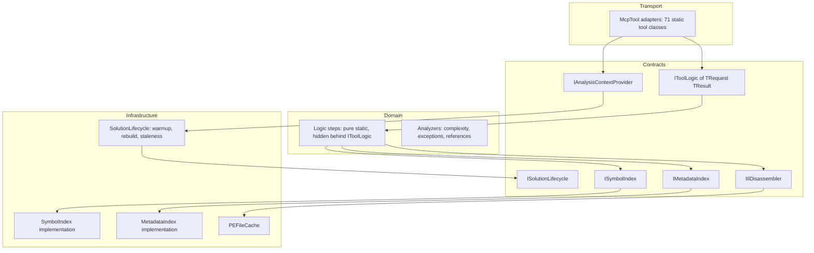
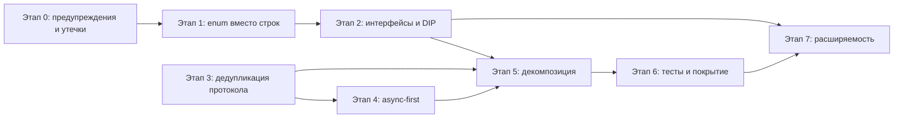

# SOLID-аудит решения `RoslynCodeLens.slnx`

Дата аудита: 2026-10-28.
Метод: MCP-сервер `roslyn-codelens` (скилл `solid-architecture-audit`), только чтение.
Объект: единственное решение репозитория — 3 проекта (`src/RoslynCodeLens`,
`tests/RoslynCodeLens.Tests`, `benchmarks/RoslynCodeLens.Benchmarks`).

---

## 0. Сводка окружения (факты)

| Проверка | Результат |
|---|---|
| `list_solutions` | 1 решение, `isActive: true`, `status: ready`, `skippedProjects: []` |
| Ошибки компиляции | **0** |
| Предупреждения компилятора | **5** (2× CS0618 устаревший `Workspace.WorkspaceFailed`, 2× CS8619 nullability в `SolutionLoader`, 1× CS8602 в `ValidateEditLogic`) |
| Публичных записей API | **1587**, из них **0 интерфейсов** |
| Циклы зависимостей (project/namespace) | **0** |
| Нарушения слоистости (3 правила) | **0** |
| Покрытие тестами (стат.) | **31 %** (332 / 1046), risk hotspots (CC ≥ 5) — **46** |

---

## 1. Результаты аудита

### 1.1 Что уже хорошо (существующие паттерны)

| Паттерн | Проявление | Оценка |
|---|---|---|
| Разделение транспорт / логика | `*Tool` — тонкий статический MCP-адаптер (атрибуты, валидация аргументов), `*Logic` — статическая функция, принимающая `LoadedSolution`/`SymbolResolver` | **Сильное место.** Логика детерминирована, без состояния, тестируется без MCP-хоста |
| Композиционный корень минимален | [`Program.cs:59-77`](../src/RoslynCodeLens/Program.cs:59) — 4 синглтона, всё остальное конструирует `WithToolsFromAssembly()` | Нет «расползания» конфигурации |
| Единый конверт ответа | `ToolListResult<T>` (`items`, `totalCount`, `truncated`, `limit`, `summary`) применён единообразно | Консистентный контракт для клиента |
| Снимок состояния под блокировкой | [`SolutionManager.GetAnalysisContext()`](../src/RoslynCodeLens/SolutionManager.cs:510) отдаёт `(solution, resolver, metadata)` из одного захвата `_lock` — явно задокументировано как фикс рассинхронизации (#282) | Осознанная работа с identity-инвариантами Roslyn |
| Структурированные ошибки | `StructuredErrorToolWrapper` + `McpToolException` + enum `ToolErrorCode` (**enum, не строки**) | Типизированные коды ошибок вместо магии строк |
| Доменные модели типизированы | 126 `record` + 17 `enum` (`AsyncViolationPattern`, `DisposableMisusePattern`, `PublicApiKind`, …) | ISP/типобезопасность на уровне моделей — в порядке |
| Защита от устаревших данных | Дренаж снимка перед перестройкой, восстановление при сбое ([`RebuildIfStale()`](../src/RoslynCodeLens/SolutionManager.cs:226)) | Аккуратная обработка гонок |
| Отказ от повторной сериализации | Рендереры возвращают типизированные `record`, а не JSON-строки | Дефект «двойная сериализация» **отсутствует** |
| Отсутствие потери типа | Коллекции объявлены как `IReadOnlyList<TOther>`; нет `IReadOnlyList<object>` + `item is T` | Дефект «потеря типа при фильтрации» **отсутствует** |

### 1.2 Подтверждённые дефекты

| # | Дефект | Механизм | Ссылки |
|---|---|---|---|
| D1 | **Тройное дублирование протокола доступа** | `GetLoadedSolution`, `GetResolver`, `GetMetadataResolver`, `GetAnalysisContext` содержат **побайтово одинаковый** префикс: `ThrowIfLoadFailed()` → `_warmupTask?.GetAwaiter().GetResult()` → проверка `_warmupException` → `RebuildIfStale()` | [`SolutionManager.cs:153`](../src/RoslynCodeLens/SolutionManager.cs:153), [`:163`](../src/RoslynCodeLens/SolutionManager.cs:163), [`:173`](../src/RoslynCodeLens/SolutionManager.cs:173), [`:510`](../src/RoslynCodeLens/SolutionManager.cs:510) |
| D2 | **Sync-over-async в горячем пути** | 5 точек `.GetAwaiter().GetResult()`. Внутри — `RebuildAsync(snapshot)`, то есть **инкрементальная перестройка проекта блокирует поток на всё время рекомпиляции**. Тот же антипаттерн в 4 аксессорах + `RebuildIfStale` | [`SolutionManager.cs:156`](../src/RoslynCodeLens/SolutionManager.cs:156), [`:166`](../src/RoslynCodeLens/SolutionManager.cs:166), [`:176`](../src/RoslynCodeLens/SolutionManager.cs:176), [`:188`](../src/RoslynCodeLens/SolutionManager.cs:188), [`:254`](../src/RoslynCodeLens/SolutionManager.cs:254) |
| D3 | **Ожидание перестройки повторяется 4 раза** | `RebuildIfStale()` вызывается из каждого геттера. Если решение «протухло», первый геттер ждёт полную перестройку; при `GetAnalysisContext()` — ожидание перед захватом `_lock`, что дополнительно расширяет окно гонки | [`SolutionManager.cs:226-267`](../src/RoslynCodeLens/SolutionManager.cs:226) |
| D4 | **Дублирование тел геттеров = 4 копии одного инварианта** | Любое изменение протокола (например, добавление health-проверки) требует правки в 4 местах; рассинхронизация одного из них даёт трудноуловимый дефект | там же |
| D5 | **`MetadataSymbolResolver` не кэшируется при создании** | Конструктор — простое присваивание двух полей ([`MetadataSymbolResolver.cs:11-15`](../src/RoslynCodeLens/Symbols/MetadataSymbolResolver.cs:11)), поэтому пересоздание дёшево, **но** проверка отсутствует в явном виде: инвариант «пересоздавать можно» нигде не зафиксирован | [`MetadataSymbolResolver.cs:11`](../src/RoslynCodeLens/Symbols/MetadataSymbolResolver.cs:11) |
| D6 | **Дублирование `Anns`/nullability-проверки** | 4× `if (_warmupException != null) throw new InvalidOperationException("Solution warmup failed.", _warmupException);` — сообщение захардкожено строкой в 4 местах | как D1 |
| D7 | **9 предупреждений `DisposableNotDisposed`** | Часть — ложные (Task в `ChangeSignatureBridge`, `Task.Run` в `SolutionChangeSafety`), но `IlDisassemblerAdapter`/`PeekIlLogic` с `_cache.Get(assemblyPath)` — **реальные** кандидаты на утечку PEFile | [`IlDisassemblerAdapter.cs:19`](../src/RoslynCodeLens/Metadata/IlDisassemblerAdapter.cs:19), [`:21`](../src/RoslynCodeLens/Metadata/IlDisassemblerAdapter.cs:21), [`PeekIlLogic.cs:225`](../src/RoslynCodeLens/Tools/PeekIlLogic.cs:225) |
| D8 | **Предупреждения компилятора в загрузчике** | `Workspace.WorkspaceFailed` помечен `[Obsolete]` (нужен `RegisterWorkspaceFailedHandler`), 2× CS8619 (несоответствие `Task<Solution>` / `Task<Solution?>`), CS8602 в `ValidateEditLogic` | [`SolutionLoader.cs:144`](../src/RoslynCodeLens/SolutionLoader.cs:144), [`:154`](../src/RoslynCodeLens/SolutionLoader.cs:154), [`:360`](../src/RoslynCodeLens/SolutionLoader.cs:360), [`:373`](../src/RoslynCodeLens/SolutionLoader.cs:373), [`ValidateEditLogic.cs:101`](../src/RoslynCodeLens/Tools/ValidateEditLogic.cs:101) |

> Дефектов класса «потеря данных при фильтрации по типу», «двойная сериализация»,
> «несогласованные парсеры» и «Service Locator» (`GetRequiredService<T>` вне
> композиционного корня) **не обнаружено** — проверено трассировкой `find_references`
> по 51 вызову `GetAnalysisContext()`.

### 1.3 Нарушения SOLID

#### SRP — нарушен

| Проявление | Метрика | Ссылка |
|---|---|---|
| `SolutionManager` — 51 член, 647 строк, 22+ ответственности | `find_large_classes` | [`SolutionManager.cs:10`](../src/RoslynCodeLens/SolutionManager.cs:10) |
| `SolutionLoader` — 22 члена, **731 строка**, `OpenPerProjectAsync` CC=23 / cognitive=50 | `find_large_classes`, `get_complexity_metrics` | [`SolutionLoader.cs:10`](../src/RoslynCodeLens/SolutionLoader.cs:10), [`:278`](../src/RoslynCodeLens/SolutionLoader.cs:278) |
| `SymbolResolver` — **45 членов**, 13 полей, 414 строк, 6 входящих namespace — единственный god-object по метрике размер×зацепление | `find_god_objects` (3 size axes + 1 coupling axis) | [`SymbolResolver.cs:7`](../src/RoslynCodeLens/SymbolResolver.cs:7) |
| `GenerateTestSkeletonLogic` — 18 членов, 530 строк: резолвинг символа + выбор фреймворка + генерация C#-текста | `find_large_classes` | [`GenerateTestSkeletonLogic.cs:10`](../src/RoslynCodeLens/Tools/GenerateTestSkeletonLogic.cs:10) |
| `ChangeSignatureBridge` — 525 строк: рефлексия + межверсионная совместимость Roslyn + доменная логика изменения сигнатуры | `find_large_classes`; 5 из 13 reflection usages | [`ChangeSignatureBridge.cs:25`](../src/RoslynCodeLens/Analysis/ChangeSignatureBridge.cs:25) |
| `FindAsyncViolationsLogic.Execute` — CC=27, **cognitive=66**, вложенность 5. Один метод ищет 6 классов нарушений | худший метод решения | [`FindAsyncViolationsLogic.cs:14`](../src/RoslynCodeLens/Tools/FindAsyncViolationsLogic.cs:14) |
| `FindObsoleteUsageLogic.Execute` — CC=24, cognitive=61 | 2-й худший | [`FindObsoleteUsageLogic.cs:11`](../src/RoslynCodeLens/Tools/FindObsoleteUsageLogic.cs:11) |

#### OCP — ослаблен

| Проявление | Ссылка |
|---|---|
| 71 инструмент жёстко зашит как `static`-метод с атрибутом `[McpServerTool]`; добавление инструмента = правка исходников, расширения извне нет | `Tools/*Tool.cs` (71 файл) |
| Цепочка из 6 `if (direction is "...")` / сравнений строк направления и `kind` правил архитектуры вместо `enum` + полиморфизма | [`GetCallGraphLogic.cs:31`](../src/RoslynCodeLens/Tools/GetCallGraphLogic.cs:31), [`CheckArchitectureLogic.cs`](../src/RoslynCodeLens/Tools/CheckArchitectureLogic.cs:56) |
| Определение «тестового проекта» и фильтры мёртвого кода реализованы статическими хелперами, а не подменяемой стратегией | [`DeadCodeFilters.cs:65`](../src/RoslynCodeLens/Tools/DeadCodeFilters.cs:65) |

#### LSP — не нарушен

Реализаций интерфейсов в репозитории нет, иерархий наследования в прикладном коде нет.
Риск отсутствует по причине отсутствия контрактов (см. ISP/DIP) — это проблема
*другого* рода: нечего нарушать, потому что нет полиморфизма вообще.

#### ISP — нарушен (в наследственной форме)

| Проявление | Ссылка |
|---|---|
| **0 интерфейсов на 1587 публичных записей.** Все `*Tool`, `*Logic`, `*Manager`, `*Loader`, `*Resolver` — конкретные типы | `get_public_api_surface`: `byKind.Interface` отсутствует |
| `*Logic.Execute` повсеместно принимает 3–8 позиционных параметров (`loaded, resolver, metadata, symbol, direction, maxDepth, maxNodes, ct`); параметр-объект (контекст) не выделен | [`GetCallGraphLogic.cs:18`](../src/RoslynCodeLens/Tools/GetCallGraphLogic.cs:18), [`GetInstantiationOptionsLogic.cs:41`](../src/RoslynCodeLens/Tools/GetInstantiationOptionsLogic.cs:41), [`ValidateEditLogic.cs:23`](../src/RoslynCodeLens/Tools/ValidateEditLogic.cs:23) |
| `SolutionManager` публикует 4 пересекающихся аксессора состояния + управление жизненным циклом + `Dispose` + `RecentlyChangedDocuments` в одном типе | [`SolutionManager.cs:148-190`](../src/RoslynCodeLens/SolutionManager.cs:148) |

#### DIP — нарушен

| Проявление | Ссылка |
|---|---|
| Все 51 вызов `GetAnalysisContext()` зависят от **конкретного** `MultiSolutionManager`; подменить в тесте нечем | [`GetCallGraphTool.cs:37`](../src/RoslynCodeLens/Tools/GetCallGraphTool.cs:37) (типичный сайт) |
| `MultiSolutionManager` публикует конкретные `SolutionManager`, `SymbolResolver`, `MetadataSymbolResolver`, `IlDisassemblerAdapter` — ни одной абстракции | [`MultiSolutionManager.cs:74-86`](../src/RoslynCodeLens/MultiSolutionManager.cs:74) |
| `SolutionManager` держит `FileChangeTracker`, `PEFileCache`, `ShadowCopyAnalyzerAssemblyLoader` как поля с конкретными типами | [`SolutionManager.cs:10`](../src/RoslynCodeLens/SolutionManager.cs:10) |

### 1.4 Антипаттерны

| Антипаттерн | Да / нет | Свидетельство |
|---|---|---|
| Статические классы-сервисы (не подменяются в тестах) | **Да** | Все 50+ `*Logic` — `public static class` |
| Sync-over-async | **Да** | 5 сайтов `GetAwaiter().GetResult()` в `SolutionManager` |
| Дублирование логики | **Да** | 4 копии протокола warmup+rebuild (D1), 4 копии строки исключения (D6) |
| Singleton с изменяемым состоянием | **Да** | `MultiSolutionManager` / `SolutionManager` — синглтоны с `_loaded`, `_resolver`, `_metadataResolver`, `_tracker`, `_recentChanges`; трогаются из всех инструментов |
| Магические строки вместо `enum` | **Да (локально)** | `direction` (`"callees"/"callers"/"both"`), `kind` правил архитектуры (`"forbid"/"allowOnly"`), `lifetime` DI, `scope` доверия (`"session"/"persistent"/"addRoot"`) |
| Публичные поля | **Почти нет** | `Field`-записи публичного API — `const`/`static readonly` константы (`DefaultPort`, `AllKinds`, `DanglingLimit`, `ForbidKind`) |
| God objects (размер × зацепление) | **1** | `SymbolResolver` |
| Утечки `IDisposable` | **Частично** | 9 предупреждений, из них реальны `IlDisassemblerAdapter`/`PeekIlLogic` (`PEFile` из кэша) |
| Мёртвый код | **124 кандидата** (prod) | `find_unused_symbols`; требуют перепроверки `find_references` |
| Рефлексия | **13 сайтов**, 10 из них — `ChangeSignatureBridge` | осознанный межверсионный мост, но изолирован плохо |
| `[Obsolete]` в использовании | **Да** | `Workspace.WorkspaceFailed` в `SolutionLoader` (CS0618) |
| Мутируемое общее состояние между вызовами | **Да** | `_metadataResolver` пересоздаётся при перестройке, `_loaded` подменяется — читатели должны пройти через `GetAnalysisContext()` |

### 1.5 Метрики проблемных классов

| Класс | CC (max метод) | Cognitive (max) | LOC | Члены | Зацепление (in/out namespace) |
|---|---|---|---|---|---|
| `SolutionLoader` | **23** (`OpenPerProjectAsync`) | **50** | **731** | 22 | — |
| `SolutionManager` | — | — | **647** | **51** | — |
| `GenerateTestSkeletonLogic` | 8 | — | **530** | 18 | — |
| `ChangeSignatureBridge` | 21 (`Members.Resolve`) | 18 | **525** | 15 | — |
| `ChangeSignatureLogic` | 9 | — | **507** | 16 | — |
| `SymbolResolver` | — | — | **414** | **45** | **6** / 2 (god-object) |
| `FindAsyncViolationsLogic` | **27** | **66** | — | — | — |
| `StackTraceParser` | 26 (`TryParseFrame`) | 29 | — | — | — |
| `GetCallGraphLogic` | 25 (`EnumerateOutgoingCalls`) | 37 | — | — | — |
| `FindObsoleteUsageLogic` | 24 | **61** | — | — | — |
| `CheckArchitectureLogic` | 22 (`ExecuteCore`) | 55 | — | — | — |

Пороговые значения из скилла: CC > 15 — декомпозиция; cognitive > 25 — тяжело читать;
LOC > 300 и члены > 15 — god-класс; ≥ 5 namespace — сильное зацепление.
**Превышено 22 методами по CC ≥ 15** (среднее 19.4, максимум 27).

---

## 2. Целевая архитектура

Ключевые изменения относительно текущего состояния:
`Transport → конкретный Manager` заменяется на `Transport → интерфейс`;
`*Logic` перестаёт быть `static` там, где это мешает подмене, и получает
типизированный объект-запрос; узкие обязанности `SolutionManager` разъезжаются по
`ISolutionLifecycle` (жизненный цикл) и `IAnalysisContextProvider` (снимок).

---

## 3. Поэтапный план

### Этап 0 — неотложные дефекты (без изменения структуры)

**Цель:** убрать предупреждения компилятора и подтверждённые утечки, не трогая дизайн.

| Изменение | Файл |
|---|---|
| [x] Заменить `Workspace.WorkspaceFailed` на `RegisterWorkspaceFailedHandler()` | [`SolutionLoader.cs:144`](../src/RoslynCodeLens/SolutionLoader.cs:144), [`:360`](../src/RoslynCodeLens/SolutionLoader.cs:360) |
| [x] Устранить CS8619: привести `Task<Solution>`/`Task<Project>` к `Task<Solution?>`/`Task<Project?>` | [`SolutionLoader.cs:154`](../src/RoslynCodeLens/SolutionLoader.cs:154), [`:373`](../src/RoslynCodeLens/SolutionLoader.cs:373) |
| [x] Устранить CS8602 (разыменование в `ValidateEditLogic`) | [`ValidateEditLogic.cs:101`](../src/RoslynCodeLens/Tools/ValidateEditLogic.cs:101) |
| [x] Проверить владение `PEFile` из `_cache.Get(...)`: документировать контракт кэша или обернуть в `using` | [`IlDisassemblerAdapter.cs:19`](../src/RoslynCodeLens/Metadata/IlDisassemblerAdapter.cs:19), [`:21`](../src/RoslynCodeLens/Metadata/IlDisassemblerAdapter.cs:21), [`PeekIlLogic.cs:225`](../src/RoslynCodeLens/Tools/PeekIlLogic.cs:225) |
| [~] Зафиксировать в коде, что 6 предупреждений о `Task` — ложные (комментарий/подавление по месту) | [`ChangeSignatureBridge.cs:65`](../src/RoslynCodeLens/Analysis/ChangeSignatureBridge.cs:65), [`:101`](../src/RoslynCodeLens/Analysis/ChangeSignatureBridge.cs:101), [`SolutionChangeSafety.cs:144`](../src/RoslynCodeLens/SolutionChangeSafety.cs:144), [`:153`](../src/RoslynCodeLens/SolutionChangeSafety.cs:153), [`BackgroundTaskStore.cs:90`](../src/RoslynCodeLens/BackgroundTasks/BackgroundTaskStore.cs:90), [`MultiSolutionManager.cs:237`](../src/RoslynCodeLens/MultiSolutionManager.cs:237) |

**Затронутые области:** загрузчик решения, IL-подсистема, валидация правок.
**Критерий готовности:** `get_diagnostics` по решению — 0 errors, 0 warnings;
`find_disposable_misuse` — 0 реальных нарушений (остальные подавлены с обоснованием).
**Влияние на поведение:** отсутствует (предупреждения + подписка на события).
**Риски:** `RegisterWorkspaceFailedHandler` может изменить поток событий —
проверить, что диагностики загрузки по-прежнему попадают в `LoadedSolution.LoadDiagnostics`.

**Примечание по пункту 5 (выполнен со сменой подхода).** `find_disposable_misuse` —
собственный анализатор проекта, и механизма подавления у него **нет**: `IsDisposalAcknowledged`
распознаёт только `return x`, присваивание в поле/свойство и в `out`/`ref`. Ни
`[SuppressMessage]`, ни `#pragma`, ни атрибут-маркер не читаются, поэтому «точечное
подавление» из плана нереализуемо. Решено задокументировать находки по месту.

Отдельно зафиксировано (проверено тестами и откачено):
- `RegisterWorkspaceFailedHandler` возвращает `IDisposable` — подписка обёрнута в `using`,
  иначе инструмент выдавал 2×`DisposableDiscarded` (регрессия была и устранена);
- переписывание `Task`-сайтов в `ChangeSignatureBridge` под «присваивание полю»
  **ломает** код: поле не переживает `await` (продолжение на другом потоке пула) →
  28 падений `NullReferenceException` в `GetTaskResult`. Отменено.

Остаток `find_disposable_misuse` — 7 находок, все ложные по конструкции:
2×`ChangeSignatureBridge` и 2×`SolutionChangeSafety` (`Task`, освобождать не требуется),
`IlDisassemblerAdapter` (`PEFile` во владении кэша; `PlainTextOutput` не `IDisposable`),
`PeekIlLogic` (`PEFile` во владении кэша), `BackgroundTaskStore` (освобождение ниже,
через `removed.Dispose()`), `MultiSolutionManager` (владение передаётся в `_managers`).

Статус: этап 0 завершён 2026-10-28

### Этап 1 — типобезопасность домена (enum вместо строк)

**Цель:** убрать магические строки из публичных контрактов.

| Изменение | Файл |
|---|---|
| `enum CallGraphDirection { Callees, Callers, Both }`; парсинг строки — только на границе инструмента | [`GetCallGraphLogic.cs:31`](../src/RoslynCodeLens/Tools/GetCallGraphLogic.cs:31), [`GetCallGraphTool.cs:24`](../src/RoslynCodeLens/Tools/GetCallGraphTool.cs:24) |
| `ArchitectureRule.Kind` типа `enum ArchitectureRuleKind { Forbid, AllowOnly }` (сейчас строки `"forbid"/"allowOnly"`) | [`ArchitectureRule.cs:10`](../src/RoslynCodeLens/Models/ArchitectureRule.cs:10), [`CheckArchitectureLogic.cs:56`](../src/RoslynCodeLens/Tools/CheckArchitectureLogic.cs:56) |
| `enum TrustScope { Session, Persistent, AddRoot }` вместо `string scope` | [`TrustSolutionLogic.cs:7`](../src/RoslynCodeLens/Tools/TrustSolutionLogic.cs:7), [`TrustSolutionTool.cs:14`](../src/RoslynCodeLens/Tools/TrustSolutionTool.cs:14) |
| `enum DiLifetime` вместо строки `lifetime` в `DiRegistration` | [`DiRegistration.cs:6`](../src/RoslynCodeLens/Models/DiRegistration.cs:6) |
| Единая точка парсинга строк→enum на границе MCP (одна функция, один формат ошибки) | новый `Tools/ArgumentParsing.cs` |

**Затронутые области:** модели, 4+ инструмента, тесты соответствующих Logic.
**Критерий готовности:** ни один `switch`/`if` прикладной логики не сравнивает строковые
литералы направления/вида/scope; ошибка неверного значения — типизированный
`McpToolException(ToolErrorCode.InvalidArgument)`.
**Влияние на поведение:** сообщения об ошибках могут измениться по формулировке;
значения, принимаемые из JSON, — без изменений (обратная совместимость на границе).
**Риски:** `ArchitectureRule` — часть публичного API модели; правка сигнатуры меняет
публичную поверхность — выполнять через `change_signature` с `preview: true`.

### Этап 2 — интерфейсы и DIP

**Цель:** ввести контракты, которые можно подменять, не переписывая всё разом.

| Изменение | Файл |
|---|---|
| `IAnalysisContextProvider` с единственным членом `SolutionAnalysisContext GetAnalysisContext()`; `MultiSolutionManager` реализует его | [`MultiSolutionManager.cs:84`](../src/RoslynCodeLens/MultiSolutionManager.cs:84) |
| `ISolutionLifecycle` (`EnsureLoaded`, `ForceReloadAsync`, `LoadSolutionAsync`, `UnloadSolution`, `SetActiveSolution`, `ListSolutions`) — управление вынести из аксессоров контекста | [`MultiSolutionManager.cs:74-86`](../src/RoslynCodeLens/MultiSolutionManager.cs:74) |
| `ISymbolIndex` / `IMetadataIndex` — то, что реально нужно `*Logic` (`FindMethods`, `FindNamedTypes`, `GetFileAndLine`, …), вместо конкретных `SymbolResolver`/`MetadataSymbolResolver` | [`SymbolResolver.cs:7`](../src/RoslynCodeLens/SymbolResolver.cs:7), [`MetadataSymbolResolver.cs:6`](../src/RoslynCodeLens/Symbols/MetadataSymbolResolver.cs:6) |
| 51 сайт `MultiSolutionManager manager` в `*Tool` заменить на `IAnalysisContextProvider` (тип параметра MCP-инструмента меняется на интерфейс) | 51 файл `Tools/*Tool.cs` |
| Зафиксировать контракт неизменяемости `MetadataSymbolResolver` (D5) — комментарием или `sealed`, чтобы пересоздание оставалось законным | [`MetadataSymbolResolver.cs:11`](../src/RoslynCodeLens/Symbols/MetadataSymbolResolver.cs:11) |

**Затронутые области:** весь слой инструментов, DI-регистрация в `Program.cs`.
**Критерий готовности:** `*Tool` не упоминает `MultiSolutionManager`; в тестах появилась
возможность подставить фейковый `IAnalysisContextProvider` без загрузки решения.
**Влияние на поведение:** отсутствует (структурная правка).
**Риски:** DI MCP-хоста конструирует инструменты по параметрам `Execute`; смена типа
параметра на интерфейс требует регистрации `IAnalysisContextProvider` в
[`Program.cs:59-77`](../src/RoslynCodeLens/Program.cs:59). Проверить `WithToolsFromAssembly()`
на разрешение интерфейсных параметров — при отказе оставить конкретный тип и свести
этап к тестовой подмене через фабрику.

### Этап 3 — устранение дублирования и стандартизация доступа к состоянию

**Цель:** один протокол доступа к снапшоту вместо четырёх (D1, D3, D4, D6).

> Порядок внутри этапа обязателен: **сначала** характеристические тесты на текущее
> поведение геттеров, **потом** рефакторинг.

| Изменение | Файл |
|---|---|
| [x] Характеристические тесты: `GetLoadedSolution`/`GetResolver`/`GetMetadataResolver`/`GetAnalysisContext` при (а) неудачной загрузке, (б) упавшем warmup, (в) протухшем решении — одинаковое ли поведение? | `tests/RoslynCodeLens.Tests/SolutionManagerTests.cs` |
| [x] Свернуть 4 копии префикса в один приватный `EnsureReady()` (сведено 5 — плюс `EnsureLoaded`) | [`SolutionManager.cs:153`](../src/RoslynCodeLens/SolutionManager.cs:153), [`:163`](../src/RoslynCodeLens/SolutionManager.cs:163), [`:173`](../src/RoslynCodeLens/SolutionManager.cs:173), [`:510`](../src/RoslynCodeLens/SolutionManager.cs:510) |
| [x] Единое сообщение «warmup failed» — константа, а не 4 строковых литерала | там же |
| [x] Решить, остаются ли индивидуальные геттеры публичными; при отсутствии внешних потребителей — сделать `internal` (проверено: единственный потребитель — `MultiSolutionManager`, см. D1). **Решение:** не сужать, а удалить `GetResolver`/`GetMetadataResolver` — потребителей не осталось | [`MultiSolutionManager.cs:74-86`](../src/RoslynCodeLens/MultiSolutionManager.cs:74) |

**Затронутые области:** `SolutionManager`, `MultiSolutionManager`, тесты решения.
**Критерий готовности:** протокол доступа к снапшоту существует в одном экземпляре;
характеристические тесты зелёные до и после; `dotnet test RoslynCodeLens.slnx` — без регрессий.
**Влияние на поведение:** должно быть нулевым; расхождение тестов «до/после» означает,
что копии уже разошлись, и это отдельный дефект — зафиксировать.
**Риски:** среднее. Геттеры вызываются из `MultiSolutionManager` (4 сайта) и тестов (3 сайта);
`find_references` по каждому перед сужением видимости.

**Результат:** протокол свёрнут в единственный `EnsureReady()`; `GetAnalysisContext()` =
протокол + `lock (_lock)`; `GetResolver`/`GetMetadataResolver` удалены
(`find_references` = 0); `GetIlDisassembler()` оставлен осознанным исключением
(адаптер не читает состояние решения). `get_diagnostics` 0/0,
`dotnet test RoslynCodeLens.slnx` — 1249 passed / 0 failed.
Сценарий (б) «упавший warmup» тестом не покрыт — нет детерминированной тест-симы.
Подробности — [`decision/2026-10-28T18-43-stage3-snapshot-access-protocol.md`](../decision/2026-10-28T18-43-stage3-snapshot-access-protocol.md).

**Статус: этап 3 завершён 2026-10-28**

#### 3.1. Уточнённые факты (проверено 2026-10-28 после этапа 0)

Перепроверено `find_references` и чтением тестов — уточняет форму рефакторинга:

| Факт | Следствие |
|---|---|
| `GetLoadedSolution`: 4 прод-сайта (все в `MultiSolutionManager`) + 3 тест-сайта | Сужение до `internal` невозможно без `InternalsVisibleTo`; проще оставить `public` и свести тело |
| `GetResolver`: **1** прод-сайт ([`MultiSolutionManager.cs:76`](../src/RoslynCodeLens/MultiSolutionManager.cs:76)) + **5** тест-сайтов | Кандидат на удаление после перевода `MultiSolutionManager` на `GetAnalysisContext()` |
| `GetMetadataResolver`: **1** прод-сайт ([`MultiSolutionManager.cs:77`](../src/RoslynCodeLens/MultiSolutionManager.cs:77)), тестов нет | Однозначный кандидат на удаление |
| **`GetIlDisassembler()` ([`SolutionManager.cs:183`](../src/RoslynCodeLens/SolutionManager.cs:183)) — тело `=> _ilAdapter` без блокировки и без проверки загрузки — контраст с остальными аксессорами** | Пятый, «недоделанный» случай той же ответственности: доступа к снапшоту без протокола готовности |
| ⚠️ **`WaitForWarmupAsync()` возвращает `_warmupTask` «как есть»** ([`SolutionManager.cs:148`](../src/RoslynCodeLens/SolutionManager.cs:148)), а `CreateAsync` стартует warmup в фоне ([`SolutionManager.cs:99`](../src/RoslynCodeLens/SolutionManager.cs:99)) | **Жёсткое ограничение:** `CreateAsync` обязан оставаться неблокирующим — это закреплено тестом [`SolutionManagerTests.cs:101`](../tests/RoslynCodeLens.Tests/SolutionManagerTests.cs:101) `CreateAsync_ReturnsBeforeCompilationCompletes`. Поэтому warmup **нельзя** переносить в `CreateAsync`; `EnsureReady()` должен блокирующе ждать warmup только при **первом доступе**, как сейчас |
| Тест [`GetResolver_ReturnsCachedInstance_WhenNotStale`](../tests/RoslynCodeLens.Tests/SolutionManagerTests.cs:30) фиксирует «без stale → тот же экземпляр» | Инвариант идентичности резолвера обязателен: `EnsureReady()` не должен пересоздавать `_resolver` при отсутствии stale-проектов |

#### 3.2. Уточнённый порядок пунктов

1. **Характеристические тесты** (без правки прода): зафиксировать текущее поведение пяти
   аксессоров по трём сценариям — (а) `HasLoadFailure` → исключение с исходным сообщением,
   (б) упавший warmup → `InvalidOperationException("Solution warmup failed.")`,
   (в) stale-проекты → перестройка перед отдачей значения. Плюс отдельно текущее поведение
   `GetIlDisassembler()` (не бросает и не ждёт — зафиксировать как **дефект D3-новый**,
   а не как норму).
2. **Свернуть 4 копии в один приватный `EnsureReady()`**; сообщение — в `const string`.
3. **`GetAnalysisContext()` переписать на `EnsureReady()` + `lock (_lock)`** (сохранить
   атомарность снимка — инвариант из комментария о #282).
4. **`MultiSolutionManager`: перевести 4 геттера на `GetAnalysisContext()`**, затем удалить
   `GetResolver` и `GetMetadataResolver` из `SolutionManager` (после чего `find_references` = 0).
5. **`GetIlDisassembler()`** — либо включить в общий протокол (если адаптер зависит от
   загруженного решения), либо оставить осознанным исключением с комментарием-обоснованием.
   Решение принимать по факту: посмотреть, читает ли `IlDisassemblerAdapter` состояние решения.
6. **Перенацелить тест-сайты** `GetResolver()` → `GetAnalysisContext().Resolver`.

### Этап 4 — async-first доступ к контексту (устранение sync-over-async)

**Цель:** инкрементальная перестройка перестаёт блокировать поток вызова.

| Изменение | Файл |
|---|---|
| Ввести `Task<SolutionAnalysisContext> GetAnalysisContextAsync(CancellationToken)` с честным `await` перестройки | [`SolutionManager.cs:510`](../src/RoslynCodeLens/SolutionManager.cs:510) |
| Синхронный `RebuildIfStale()` превратить в `RebuildIfStaleAsync()` | [`SolutionManager.cs:226`](../src/RoslynCodeLens/SolutionManager.cs:226), [`:254`](../src/RoslynCodeLens/SolutionManager.cs:254) |
| `*Tool.Execute` → `ExecuteAsync` там, где вызывается перестройка (сейчас `Execute` синхронны у 40+ инструментов) | `Tools/*Tool.cs` |
| Оставить документированный синхронный путь только для «тёплого» быстрого сценария (без stale-проектов) | [`SolutionManager.cs:185`](../src/RoslynCodeLens/SolutionManager.cs:185) |

**Затронутые области:** все инструменты, `MultiSolutionManager`, обработка отмены.
**Критерий готовности:** `find_async_violations` — 0 вхождений `SyncOverAsyncGetAwaiterGetResult`
в `src/`; перестройка отменяется по `CancellationToken`; инструменты возвращают
`OperationCanceledException` наружу без изменений (как сейчас задумано в
[`Program.cs:66-68`](../src/RoslynCodeLens/Program.cs:66)).
**Влияние на поведение:** при протухшем решении вызов больше не занимает поток;
латентность ответа не меняется (перестройка всё равно нужна), меняется масштабируемость.
**Риски:** **высокие.** 40+ сигнатур, MCP-хост ожидает либо `T`, либо `Task<T>` —
менять по одному инструменту с прогоном тестов; не смешивать с этапами 2–3.

### Этап 5 — декомпозиция god-классов

**Цель:** свести LOC и CC под пороги; устранить единственный god-object.

| Изменение | Файл |
|---|---|
| `SymbolResolver` (414 LOC, 45 членов, 6 входящих namespace) → `SymbolIndex` (поиск по имени) + `TypeIndex` (иерархии, реализации) + `LocationIndex` (файл/строка/project) | [`SymbolResolver.cs:7`](../src/RoslynCodeLens/SymbolResolver.cs:7) |
| `FindAsyncViolationsLogic.Execute` (CC 27 / cognitive 66): выделить детектор на каждый из 6 шаблонов; метод верхнего уровня только собирает результаты | [`FindAsyncViolationsLogic.cs:14`](../src/RoslynCodeLens/Tools/FindAsyncViolationsLogic.cs:14) |
| `FindObsoleteUsageLogic.Execute` (CC 24 / cognitive 61): отделить обход от группировки | [`FindObsoleteUsageLogic.cs:11`](../src/RoslynCodeLens/Tools/FindObsoleteUsageLogic.cs:11) |
| `SolutionLoader.OpenPerProjectAsync` (CC 23 / cognitive 50): разбить на «открыть проект», «применить фильтр», «скомпилировать пачкой» | [`SolutionLoader.cs:278`](../src/RoslynCodeLens/SolutionLoader.cs:278) |
| `CheckArchitectureLogic.ExecuteCore` (CC 22 / cognitive 55): по одному методу на `forbid` и `allowOnly` | [`CheckArchitectureLogic.cs:56`](../src/RoslynCodeLens/Tools/CheckArchitectureLogic.cs:56) |
| `GenerateTestSkeletonLogic` (530 LOC): выделить `TestSkeletonRenderer` (генерация текста) и `TestSkeletonPlanner` (что генерировать) | [`GenerateTestSkeletonLogic.cs:10`](../src/RoslynCodeLens/Tools/GenerateTestSkeletonLogic.cs:10) |
| `GetCallGraphLogic.EnumerateOutgoingCalls` (CC 25): выделить обработку внешних узлов | [`GetCallGraphLogic.cs:179`](../src/RoslynCodeLens/Tools/GetCallGraphLogic.cs:179) |
| `StackTraceParser.TryParseFrame` (CC 26): разбить по форматам кадра | [`StackTraceParser.cs:132`](../src/RoslynCodeLens/StackTrace/StackTraceParser.cs:132) |

**Затронутые области:** резолвер, 6 инструментов, загрузчик, парсер стек-трейсов.
**Критерий готовности:** `get_complexity_metrics(threshold=15)` — 0 методов;
`find_large_classes(maxLines=300, maxMembers=15)` — 0 типов в `src/`;
`find_god_objects` — пусто; поведение подтверждено существующими тестами.
**Влияние на поведение:** нулевое (перенос кода).
**Риски:** высокие по объёму. Каждый класс декомпозировать отдельным коммитом;
`SymbolResolver` — начать с `find_references` по каждому публичному члену, чтобы
не потерять вызывающих при разнесении по трём типам.

### Этап 6 — тестируемость и покрытие

**Цель:** закрыть 46 risk hotspots и поднять покрытие с 31 %.

| Изменение | Ссылки |
|---|---|
| Самая крупная дыра — `ApplyFixLogic.ExecuteAsync` (CC 16, непокрыт) | [`ApplyFixLogic.cs:16`](../src/RoslynCodeLens/Tools/ApplyFixLogic.cs:16) |
| `FindObsoleteUsageLogic.Execute` (CC 24, непокрыт) | [`FindObsoleteUsageLogic.cs:11`](../src/RoslynCodeLens/Tools/FindObsoleteUsageLogic.cs:11) |
| `ComplexityCalculator.Calculate` (CC 16) — метрика, на которой построены пороги аудита; её ошибка искажает все отчёты | [`ComplexityCalculator.cs:20`](../src/RoslynCodeLens/Analysis/ComplexityCalculator.cs:20) |
| `ExtractMethodLogic.ExecuteAsync` (CC 16), `FindGodObjectsLogic.Execute` (CC 15) | [`ExtractMethodLogic.cs:50`](../src/RoslynCodeLens/Tools/ExtractMethodLogic.cs:50), [`FindGodObjectsLogic.cs:19`](../src/RoslynCodeLens/Tools/FindGodObjectsLogic.cs:19) |
| Паритетные тесты для пар близких инструментов (`find_callers` / `analyze_method` / `get_call_graph`) — общие правила выбора символа | `tests/RoslynCodeLens.Tests/Tools/` |
| `GetAnalysisContext` (CC 2, непокрыт) — центральная точка, через которую идут 51 инструмент | [`SolutionManager.cs:510`](../src/RoslynCodeLens/SolutionManager.cs:510) |

**Критерий готовности:** `find_uncovered_symbols` — 0 символов с CC ≥ 10;
`riskHotspotCount` снижен до единиц; покрытие ≥ 60 %.
**Влияние на поведение:** отсутствует.
**Риски:** фикстуры тяжёлые (загрузка решения) — переиспользовать существующие
`*FixtureTests`-паттерны вместо новых загрузок.

### Этап 7 — архитектурные улучшения (расширяемость)

**Цель:** снять OCP-ограничение — инструменты и правила перестают требовать правки ядра.

| Изменение | Ссылки |
|---|---|
| Ввести `IToolLogic<TRequest, TResult>` для логики, которую нужно подменять; статические `*Logic` остаются быстрым путём, но за интерфейсом | `Tools/*Logic.cs` |
| Правила архитектуры как типизированная модель с поведением (`ForbidRule`, `AllowOnlyRule`), а не `switch` по строке | [`CheckArchitectureLogic.cs`](../src/RoslynCodeLens/Tools/CheckArchitectureLogic.cs:39), [`ArchitectureRule.cs`](../src/RoslynCodeLens/Models/ArchitectureRule.cs:9) |
| Изолировать рефлексию в `ChangeSignatureBridge`: вынести межверсионный доступ в отдельный адаптер, чтобы 10 из 13 reflection usages не протекали в доменную логику | [`ChangeSignatureBridge.cs:155`](../src/RoslynCodeLens/Analysis/ChangeSignatureBridge.cs:155) |
| Пороги метрик (`CC > 15`, `LOC > 300`) — в конфигурацию, а не литералами в вызовах | [`GetProjectHealthLogic.cs:9`](../src/RoslynCodeLens/Tools/GetProjectHealthLogic.cs:9) |

**Критерий готовности:** добавление нового инструмента не требует правки существующих
типов; `find_reflection_usage` — 0 вхождений рефлексии вне `Analysis/Bridge/`.
**Влияние на поведение:** отсутствует.
**Риски:** низкие (расширение, не переписывание).

---

## 4. Зависимости этапов

Этапы 1 и 3 независимы друг от друга и могут идти параллельно.
Этап 4 **требует** этапа 3 (дедупликация уменьшает число async-сайтов с четырёх до одного).
Этап 6 идёт после декомпозиции — иначе тесты придётся переписывать дважды.

---

## 5. Глобальные критерии готовности

1. `get_diagnostics` по решению — **0 errors, 0 warnings** (сейчас 5 warnings).
2. `find_async_violations` — **0** `SyncOverAsync*` нарушений (сейчас 9).
3. `find_disposable_misuse` — **0** реальных нарушений (сейчас 9, часть ложные).
4. `get_complexity_metrics(threshold=15)` — **0** методов (сейчас 22).
5. `find_large_classes(maxLines=300, maxMembers=15)` — **0** типов в `src/` (сейчас 13).
6. `find_god_objects` — **пусто** (сейчас 1).
7. `find_circular_dependencies` и `check_architecture` — **0** (уже выполнено; не регрессировать).
8. `find_uncovered_symbols` — **0** символов с CC ≥ 10 (сейчас 46 risk hotspots).
9. Публичный API содержит **контракты** (`Interface` в `get_public_api_surface`), а не только конкретные типы.
10. Каждый этап завершён: `dotnet test RoslynCodeLens.slnx` зелёный, отдельный коммит.

---

## 6. Сводка рисков

| Риск | Этапы | Мера |
|---|---|---|
| Смена типа параметра инструмента на интерфейс ломает конструирование MCP-хостом | 2 | Проверить разрешение интерфейсных параметров `WithToolsFromAssembly()` на одном инструменте до массовой замены; при отказе — свести этап к фабрике/подмене в тестах |
| 40+ сигнатур `Execute` → `ExecuteAsync` дают большой diff и конфликты | 4 | По одному инструменту на коммит; не смешивать с этапами 2–3 и 5 |
| Разнесение `SymbolResolver` теряет вызывающих (45 публичных членов) | 5 | `find_references` по каждому члену перед переносом; `rename_symbol` вместо текстовой замены |
| Изменение публичной сигнатуры моделей (`ArchitectureRule.Kind`, `DiRegistration.Lifetime`) — breaking change для клиентов | 1 | `change_signature` с `preview: true`; при необходимости — переходный период с обоими членами |
| `RegisterWorkspaceFailedHandler` меняет поток диагностик загрузки | 0 | Тест на `LoadedSolution.LoadDiagnostics` до и после |
| Характеристические тесты в этапе 3 обнаружат **уже существующее** расхождение копий | 3 | Считать это находкой: зафиксировать и решить, какое поведение верное, до рефакторинга |
| `unload_solution`/перестройка под нагрузкой — тесты падают нестабильно | 3, 4, 6 | Переиспользовать один загруженный фикстурный solution; не грузить решение в каждом тесте |
| Пороги метрик измеряются собственным инструментом, который сам может быть неверен | все | `ComplexityCalculator.Calculate` покрыть тестами **первым** в этапе 6 |
